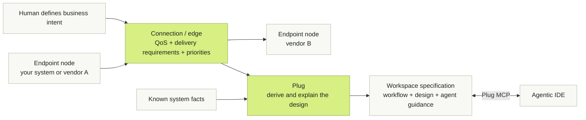
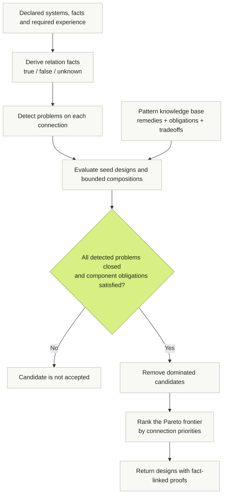
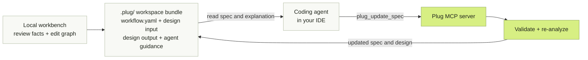

# Plug

**Define the business requirements. Connect vendor endpoints. Keep your coding agent connected to the design.**

Plug lets you model a workflow as a graph of operations from your own systems and
different vendors. Endpoints are nodes; connections are edges with their own
business requirements, quality-of-service targets, and priorities. Define the
response time, freshness, availability, delivery behavior, and tradeoffs the
business needs. Plug uses those requirements and the known system facts to derive
an explainable integration architecture.

The design stays with the project in a workspace spec. Plug exposes it through
MCP so an agentic IDE can read the requirements before changing an integration,
record changes, and re-analyze the result. Generated agent guidance tells the
coding agent how to keep that shared design current.

Plug is a deterministic design engine for the seams between systems — the places
where latency gaps, overload, duplicate side effects and trust boundaries live, and
where most production incidents are born. Describe two to eight systems and up to
twelve connections, state the operational facts you actually know, declare the
experience each connection must deliver — and Plug composes architectures that close
every detected problem, ranks a Pareto frontier by your priorities, and attaches a
proof to each result. Same input, same design, every time. No model calls, and your
endpoints are never invoked during analysis.



The result is an architecture under your declared facts and assumptions, not a
deployed integration or a measured production guarantee.

## Why

Every "just call their API" hides a design problem:

- A checkout that must respond in milliseconds depends on a supplier that answers
  in fifteen seconds.
- A traffic burst melts a partner's quota, and the retries that follow were never
  safe to repeat.
- An agent invokes an MCP tool twice and a side effect happens twice.
- The design that prevents all of this lives in one engineer's head — and the
  coding agent writing the integration never sees it.

The remedies are decades old: caches, queues, outboxes, circuit breakers,
idempotent consumers. Choosing and combining them is still folklore — senior
engineers pattern-match, everyone else guesses, and language models improvise
confidently. Plug's bet is that, given honest facts and an explicit required
experience, that choice is computable — and therefore reviewable, testable and
explainable. Integration architecture should be derived, not guessed.

## Problems Plug detects — and designs away

For every connection Plug derives three-valued relation facts (true, false or
unknown — unknown facts stay unknown, never defaulted) and checks each one:

| Detected problem         | The question it answers                                  |
| ------------------------ | -------------------------------------------------------- |
| `protocol_mismatch`      | Can the caller natively call the exposed interface?      |
| `contract_mismatch`      | Do the mappings cover the structured contracts?          |
| `first_response_gap`     | Does the live path fit the first-response budget?        |
| `capacity_overload`      | Does sustained request rate exceed the downstream quota? |
| `burst_overload`         | Do bursts exceed the downstream quota?                   |
| `availability_shortfall` | Is downstream availability below the target?             |
| `duplicate_effect`       | Can redelivery repeat a forbidden side effect?           |
| `atomic_publish`         | Must local state and a lossless message change together? |
| `ordering_gap`           | Can the channel preserve the required order?             |
| `trust_boundary`         | Does the connection cross a trust boundary?              |

A candidate architecture is accepted only if it closes every detected problem and
discharges every obligation its own components introduce: a retry must answer
duplication, every remote attempt needs a hard deadline, and requests rejected
above a limit are an explicit, acknowledged loss — never a silent one.

## How a design is derived

Six seed designs — direct, cache-aside, scheduled refresh/prefetch, progressive
response and two compositions — are evaluated against your facts. A pattern
knowledge base (17 pairwise patterns, from timeout, retry with backoff and jitter
and circuit breaker through queue-based load leveling, transactional outbox,
idempotent consumer and dead-letter channel, plus 5 global patterns) feeds a
bounded composition planner. Dominated candidates fall away, the Pareto frontier
is ranked by the priorities you set per connection, and each surviving
architecture carries a proof naming the facts it used. All of it is
deterministic: no model, no randomness, no network calls to your systems.



An unknown fact is not a passing check. Proofs retain the facts and assumptions
used, so reviewers can see what a candidate does and does not establish.

## From a graph in your browser to the agent in your IDE

```sh
npx plug ui            # local workbench at http://127.0.0.1:4319, loopback only
npx plug index . --out workspace-index.json
```

1. **Start from your code, not a blank form.** The workbench offers to index the
   current project: a bounded local scan of OpenAPI documents, Agent Cards,
   package manifests and source markers that drafts your system and lists the
   operational facts Plug still needs. It skips secrets, dependencies and
   symbolic links, and the draft is used only after you review and adopt it.
2. **Add the systems you talk to.** Paste a JSON/YAML description, import an MCP
   `tools/list` (2025-11-25) or an A2A Agent Card (1.0) — or enter a server URL
   and the workbench lists its tools or skills without calling them. Request
   headers are used once and never saved.
3. **Draw the experience you need.** The design is a workflow graph: systems are
   groups, operations are nodes, and every edge is a connection carrying its own
   required experience and priority order. Hover an operation and drag its **+**
   onto another to connect them; create, re-parent, rename, rewire or remove
   anything at any level — fullscreen if you like — and undo restores it.
4. **Exchange it as a standard.** Download or upload the graph as an
   [Open Workflow Specification](https://open-workflow-specification.org/)
   document instead of locking intent into a proprietary format.
5. **Hand it to your coding agent — and keep it honest.**

   ```sh
   npx plug spec input.json             # writes .plug/: workflow.yaml, design-input.json, design.json, design.md, AGENTS.md
   npx plug mcp install --ide cursor    # or vscode, claude, generic
   ```

   The agent reads the spec of record and updates it through the `plug mcp`
   stdio server (`plug_get_spec`, `plug_update_spec`, `plug_analyze`,
   `plug_index_workspace`, `plug_explain`), which validates and re-analyzes
   every change. The design stops living in one person's head.



MCP registration makes the design available to the IDE. The generated
`.plug/AGENTS.md` carries instructions to read it before integration changes and
update it afterward. Reference that guidance from the project instructions your
agent actually loads. The current implementation registers MCP and generates
agent guidance; it does not automatically install a separate `SKILL.md` package
or enforce every code change.

The full CLI is `plug analyze|explain|demo|index|ui|spec|mcp`.

## Run it locally

Use Node 24 (`nvm use`), then:

```sh
npm ci
npm run dev    # http://localhost:3000, stays running until Ctrl-C
```

The workbench is the first screen. The flight example uses a real 15-second HTTP
source: scheduled caching can serve eligible indicative options quickly while the
source remains slow, with a 60-second refresh inside a bounded 120-second
session. No booking or payment execution is included.

```sh
npm run check
npm run build
npm run test:browser   # npx playwright install chromium, once
npm start              # production UI and API on port 3000 or $PORT
```

## What Plug refuses to do

The guarantees are the product. Each of these is enforced in code and tests:

- **Never invokes your endpoints during hosted analysis.** Hosted execution binds
  only the bundled synthetic fixture; trusted loopback HTTP is available locally.
- **Never fills in facts.** Unknown stays unknown, and the proofs say so.
- **Never confuses a demo with production.** Coverage replay is synthetic,
  specific to each exact policy, and assumes successful bounded calls. A warm-hit
  point estimate is not a production p95; a few demo runs do not validate an SLO.
- **Never infers cache permission from annotations.** Caching is allowed only
  when you say it is.
- **Never weakens your requirements to make a design pass.**

## Scope today

Manual JSON/YAML, MCP `tools/list` and A2A Agent Cards are supported for metadata
intake; imports preserve unknown metadata and schema dialects. Schemas, mappings,
QoS, scope and cache permission may still need author input. Composed
architectures are design output; only seed designs run here. Global patterns
(backend for frontend, message bus and similar) are reported as needing global
context. No durable cache, distributed scheduler, restart recovery, OAuth sign-in
for discovery, arbitrary expression evaluation, or model-assisted extraction.

**Release status:** no public deployment or public URL has been verified.
Distribution license awaits owner choice; this repository is not yet claimed as
open source and npm publication is disabled. See
[release notes](RELEASE_NOTES.md).

## Contributing

Plug is young, the spec is a draft, and the interesting problems are open:

- **Grow the knowledge base.** Every pattern is data — the problems it closes,
  the obligations it introduces, contraindications and tradeoffs — in the
  [canonical contracts](schema/draft/schema.ts).
- **Widen intake.** New importers, richer workspace indexing and deeper MCP/A2A
  discovery live in the [reference package](packages/plug/src/index.ts).
- **Sharpen the workbench.** The graph editor, inspector and proof rendering
  live in [apps/playground](apps/playground).
- **Challenge the contract.** Major behavior, contract or process changes go
  through [SEPs](seps/README.md). Current drafts:
  [public alpha design](seps/0000-public-alpha-design.md),
  [local workbench and multi-system inference](seps/0000-local-workbench-and-multi-system.md),
  [workflow graph and OpenSpec](seps/0000-workflow-graph-and-openspec.md),
  [local MCP and A2A discovery](seps/0000-local-mcp-a2a-discovery.md).

Read [CONTRIBUTING.md](CONTRIBUTING.md) first. `npm run check`, `npm run build`
and `npm run test:browser` keep you honest. While licensing is unresolved,
[issues and ideas](https://github.com/plugproject/plug/issues) are the best entry
point.

## Learn more

- [Quickstart and custom HTTP adoption](docs/docs/quickstart.mdx)
- [Current draft specification](docs/specification/draft/index.mdx)
- [Canonical contracts](schema/draft/schema.ts) / [reference package](packages/plug/src/index.ts)
- [Deployment](docs/development/deployment.mdx)
- [Implementation status](IMPLEMENTATION.md)

The repository adapts the specification/schema/docs/SEP organization of
[modelcontextprotocol/modelcontextprotocol](https://github.com/modelcontextprotocol/modelcontextprotocol).
It does not inherit that project's governance, ownership or approvals.
